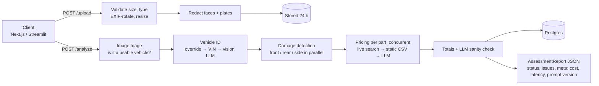

# Car Crash AI

[](https://github.com/Thytus777/car-crash-ai/actions/workflows/ci.yml)
[](https://github.com/Thytus777/car-crash-ai/actions/workflows/ci.yml?query=branch%3Amain)
[](https://github.com/Thytus777/car-crash-ai/actions/workflows/nightly.yml)
[](LICENSE)

Photos of a damaged car go in. A structured, validated repair estimate comes out: the vehicle, each damaged component with a severity score, a repair-or-replace decision, parts and labour costs, and a PDF report.

The core is a FastAPI service around vision LLMs (Gemini, with OpenAI as fallback). The interesting part is everything around the model calls that makes them dependable:
- schema-enforced outputs
- retries and provider fallback
- partial results reported as partial, never filled with guesses
- privacy redaction before any model sees a photo
- an eval harness with a CI regression gate
- tracing, metrics and SLOs
- a build-once, promote-by-digest release pipeline

## What's worth looking at

| Area | What it does | Where |
|---|---|---|
| **Reliable LLM calls** | One `generate(schema, …)` entry point. Pydantic models double as the provider's structured-output schema and the validator. Per-attempt timeouts, jittered backoff, bounded re-asks on invalid output, typed errors, and fallback to a second provider. | [`backend/app/core/llm.py`](backend/app/core/llm.py) |
| **Honest degradation** | A failed damage zone, price lookup or sanity check is reported in `issues` with `status: "partial"`. The old code turned these into "no damage" or a made-up $150 (fixed in [#3](https://github.com/Thytus777/car-crash-ai/issues/3)). | `AGENTS.md`, "Failures" |
| **Evals** | A labelled-dataset format with a fixed taxonomy and a schema-checked manifest. The harness runs the *production* pipeline and reports component P/R/F1, severity accuracy, triage, cost error, schema-valid-first-attempt, retries, latency and cost. On PRs, a CI gate compares a smoke run with a committed baseline and posts the diff as a comment. | [`evals/`](evals/README.md), [`backend/evals/`](backend/evals) |
| **Versioned prompts** | Immutable prompt files (`v1`–`v4`); every response records which version produced it ([ADR 0002](docs/adr/0002-versioned-prompt-files.md)). | [`backend/prompts/`](backend/prompts) |
| **Prompt-injection defence** | Scraped pages go inside a fence the prompt declares untrusted, and the text can't close it. Text in photos is never treated as an instruction. Extracted prices are bounds-checked in code. Outbound fetches are https-only to public IPs, re-checked on every redirect. | [`SECURITY.md`](SECURITY.md) |
| **Privacy** | Faces and number plates are blurred at upload (YuNet and a YOLOv9 plate model, sha256-pinned ONNX) before storage or any model call. Photos are deleted after 24 h ([ADR 0004](docs/adr/0004-redact-faces-and-plates-at-upload.md)). | [`docs/DATA_RETENTION.md`](docs/DATA_RETENTION.md) |
| **Observability** | JSON logs with request and trace IDs. OpenTelemetry spans per stage and per model call (`gen_ai.*` attributes, tokens, cost). Prometheus metrics, `/healthz` and `/readyz`, and SLOs with burn-rate alerts. | [`docs/SLO.md`](docs/SLO.md) |
| **Cost control** | Per-call cost on spans and metrics, a per-request cost and latency budget, a result cache for identical uploads, and model-input downscaling. Cheap-first model routing is built behind a flag, pending eval evidence ([ADR 0003](docs/adr/0003-cheap-first-model-routing.md)). | `backend/app/core/` |
| **API contract** | A committed OpenAPI spec. CI fails if it's stale or changed without a version bump, and tests check that both clients only call paths in it. Errors are RFC 9457 problem documents, with 16 documented types. | [`backend/openapi.json`](backend/openapi.json), [`docs/errors.md`](docs/errors.md) |
| **Delivery** | Every merge builds the image once: non-root, digest-pinned bases, Trivy scan, SBOM, SLSA provenance attestation. Staging gets that exact digest; a release promotes it to production after approval, verifying the attestation first. Keyless OIDC to Google Cloud. Automatic rollback if the post-deploy smoke test fails. | [`.github/workflows/`](.github/workflows), [`docs/RUNBOOK.md`](docs/RUNBOOK.md) |

## How a request flows



Every model call in that flow goes through `app/core/llm.py`, which handles schemas, retries, fallback, caching, tracing and cost accounting.

## Measured

Every number here comes from a command you can rerun.

| What | Result | Reproduce |
|---|---|---|
| Tests | 315 passing: 204 unit and 111 integration, including Hypothesis property tests | `make test-all` |
| Coverage | 90.01% with branch coverage; CI fails under 89% | `make coverage` |
| Load test, 20 users for 60 s, simulated 1.5 ± 0.5 s model latency | `/analyze` p50 6.2 s, p95 7.2 s, 0 failures in 172 requests | `make loadtest` → [`backend/loadtest/results/`](backend/loadtest/results/20261119T084211Z.md) |
| Model quality (component F1 and the rest) | **Not measured yet.** The labelled dataset is still being built ([#15](https://github.com/Thytus777/car-crash-ai/issues/15)). The eval badge and the PR gate show this, and nothing here will claim accuracy until a real run does. | `make eval` |

The load test fakes model calls with a sleep, so it measures the service's overhead and concurrency under model-like latency, not the models themselves.

## Quick start

You need [uv](https://docs.astral.sh/uv/getting-started/installation/), GNU make (Windows: `winget install ezwinports.make`) and a [Gemini API key](https://aistudio.google.com/apikey).

```bash
git clone https://github.com/Thytus777/car-crash-ai.git && cd car-crash-ai
make setup                               # deps, redaction models, git hooks
cp backend/.env.example backend/.env     # then set GEMINI_API_KEY
make run                                 # API on http://localhost:8000 (/docs)
```

Clients:

```bash
make run-demo                            # Streamlit demo on :8501
cd frontend-next && npm ci && npm run dev  # Next.js app on :3000
```

Or the whole stack with Postgres, an OpenTelemetry collector and Jaeger (traces at http://localhost:16686):

```bash
cp .env.example .env && docker compose up
```

With `API_KEYS` empty, local development runs without auth. `APP_ENV=production` refuses to start without keys, with wildcard CORS, or without redaction.

## API

| Method | Path | |
|---|---|---|
| `POST` | `/api/v1/upload` | Validate, redact and store 1–10 photos; returns `upload_id` |
| `POST` | `/api/v1/analyze` | Run the assessment; returns an `AssessmentReport` (or `vehicle_confirmation_needed`) |
| `GET` | `/api/v1/estimates`, `/api/v1/estimates/{id}` | Saved assessments |
| `GET` | `/api/v1/report/{id}` | PDF report |
| `GET` | `/healthz`, `/readyz` | Liveness, and readiness with per-check detail |
| `GET` | `/metrics` | Prometheus |

`/api/v1/*` and `/metrics` take `X-API-Key` or `Authorization: Bearer` when keys are configured. Requests are rate-limited per client. The full contract is [`backend/openapi.json`](backend/openapi.json).

## Repository map

```
backend/
  app/            FastAPI service: api/ routes, services/ pipeline stages,
                  core/ (llm, config, tracing, metrics), models/, db/
  prompts/v1-v4/  immutable prompt versions
  evals/          eval harness: dataset loader, metrics, runner, CI gate
  loadtest/       Locust load test with simulated model latency
  scripts/        model fetch, OpenAPI export, smoke test, badges
frontend-next/    Next.js client (primary)
frontend/         Streamlit demo and the eval labelling tool
evals/            dataset, taxonomy, thresholds, labelling guide
docs/             ADRs, SLOs, runbook, error catalogue, data retention
scripts/          setup_gcp.sh (guided cloud setup), badge publishing
```

## Working on it

- [`CONTRIBUTING.md`](CONTRIBUTING.md): trunk-based flow, Conventional Commits, one PR per change, squash-merge when CI is green.
- [`AGENTS.md`](AGENTS.md): conventions for people and coding agents, such as how to add a model call or change a prompt.
- `make help` lists every target, and CI runs the same ones: ruff, mypy `--strict`, tests with the coverage gate, OpenAPI contract, pip-audit, bandit, gitleaks, CodeQL, Docker build with Trivy, and the Next.js type-check and build.
- Releases come from [release-please](CHANGELOG.md). Deploying, rolling back and triage are in [`docs/RUNBOOK.md`](docs/RUNBOOK.md); first-time cloud setup is `scripts/setup_gcp.sh`.

## Status and limits

- **Accuracy is unmeasured** until the labelled dataset exists (above).
- The cloud deploy pipeline is built and runs up to the GHCR push and attestation. The Cloud Run stages switch on when `scripts/setup_gcp.sh` has been run.
- The Next.js client sends its API key from the browser. A public web deployment needs a server-side proxy ([`SECURITY.md`](SECURITY.md)).
- Rate limits are per instance (in memory).

## License

[MIT](LICENSE)
